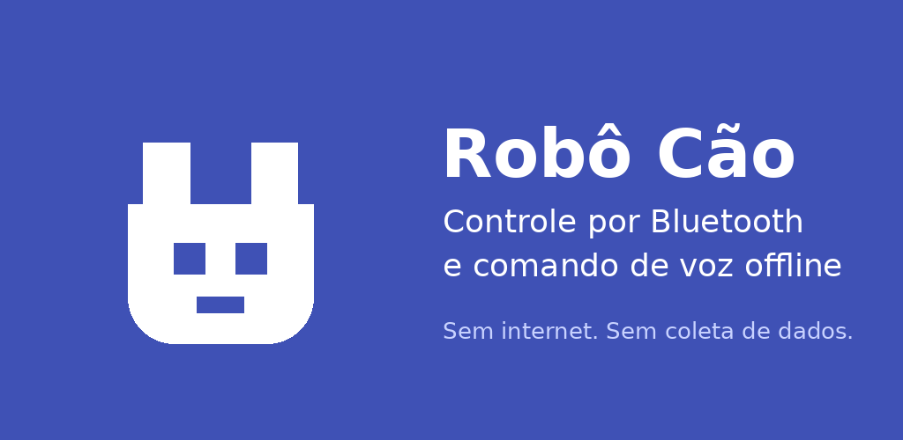
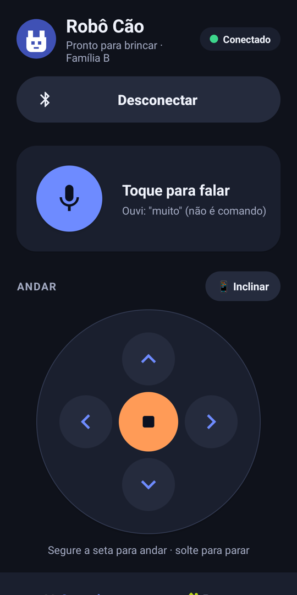
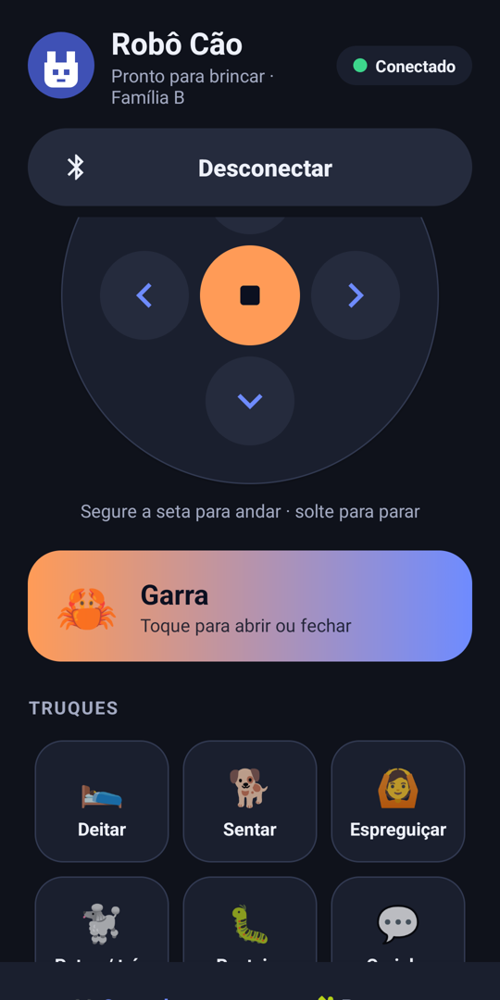
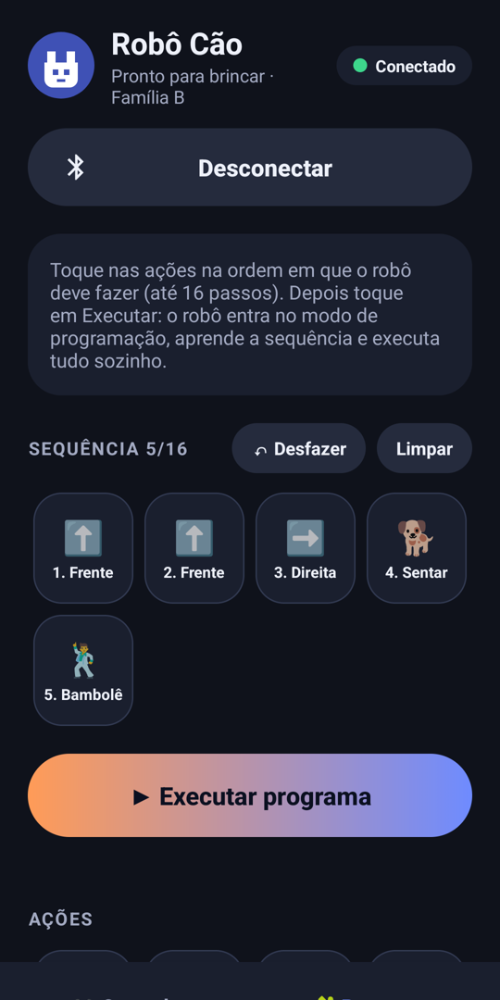

<p align="center">
  
</p>

<h1 align="center">Robô Cão</h1>

<p align="center">
  <b>Um app seguro para controlar robôs cão de brinquedo, feito a partir da engenharia reversa do app original que vinha num APK duvidoso.</b><br>
  Bluetooth LE · comando de voz 100% offline · modo programação · zero permissão de internet
</p>

<p align="center">
  
  
  
  
  
</p>

> **EN:** My son got a toy robot dog whose box QR code pointed to an APK outside the Play Store.
> I audited it, found a debug build sending children's voice to Chinese cloud services, reverse-engineered
> its Bluetooth protocol from Dalvik bytecode, and rebuilt the app from scratch: no internet permission,
> on-device voice recognition, a kids' programming mode, published on Google Play. Built in a single day
> pairing with an AI agent (Claude Code).

---

## A história

Meu filho ganhou um **robô cão de brinquedo**. O QR code da caixa não levava à Play Store: baixava direto
um arquivo `yel.apk`, de 87 MB. Antes de instalar, resolvi olhar o que tinha dentro.

**O que a análise do APK original mostrou:**

| Achado | Risco |
|---|---|
| Build de **debug** (`android:debuggable=true`) assinado com um certificado caseiro ("CN=Franklin") | Dados do app expostos via ADB; ninguém audita a origem |
| SDKs de voz **Baidu** e **iFlytek**: o microfone grava e envia a **voz da criança** para a nuvem na China | Privacidade infantil |
| `MANAGE_EXTERNAL_STORAGE`: acesso a **todos os arquivos** do celular | Permissão muito acima do necessário |
| `usesCleartextTraffic=true` e chave de API do Baidu escrita no código | Higiene de segurança ruim |

O VirusTotal deu 0/67. Não era malware, era só **descuido**. Mesmo assim, eu não queria isso no celular da família.

**Então refiz o app.**

## O que eu construí

<p align="center">
  
  &nbsp;
  
  &nbsp;
  
</p>

- 🕹️ **Controle direcional**: segure para andar, solte para parar
- 📱 **Modo inclinar**: guie o robô inclinando o celular (acelerômetro/gravidade, com zona morta e histerese)
- 🦀 **Garra**: abre e fecha (modelo com garra)
- 🐶 **Truques**: deitar, sentar, rastejar, nadar, andar em pé, bambolê, música, história e mais
- 🎤 **Comando de voz offline** em português: "senta", "pata", "dança"… processado **no aparelho**
- 🧩 **Modo programação**: a criança monta até 16 passos, corrige antes de enviar e o robô executa sozinho
- 🔁 Reconexão automática, aviso para reiniciar o robô após falhas, interface em **PT / EN / ES**, tema claro e escuro

## Antes e depois

| | App original | Robô Cão |
|---|---|---|
| Tamanho do download | 87 MB | **35,7 MB** (a primeira versão, sem voz, tinha 38 KB) |
| Permissão de internet | Sim | **Não tem** |
| Para onde vai a voz | Baidu / iFlytek (nuvem) | **Lugar nenhum**: reconhecimento offline |
| Acesso a arquivos | Todos os arquivos | **Nenhum** |
| Localização | Sempre | Só Android 8–11, onde o sistema exige para BLE |
| Build | Debug | Release minificado, sem backup |
| Distribuição | APK solto por QR code | **Google Play**, com Data Safety "nenhum dado coletado" |
| SDKs de terceiros | Baidu Speech, iFlytek SparkChain, Tencent MMKV, FastBLE, Glide, Gson… | **1** (Vosk + JNA, Apache 2.0) |

## Como foi feito

### 1. Engenharia reversa sem decompilador

Sem Java nem jadx na máquina, o protocolo saiu da leitura direta do **bytecode Dalvik** (`dexdump`)
das classes `AdvertiseDataUtil`, `AdvertiseManager` e `ControlFragment`, além de um **simulador em Python**
que reconstruiu os arrays de comandos de cada modelo a partir das instruções `new-array`/`aput`.

Descobertas principais (detalhes em **[docs/PROTOCOL.md](docs/PROTOCOL.md)**):

- O robô **não usa conexão GATT**. Tudo trafega em **anúncios BLE** (manufacturer data `0x1100`),
  com pacotes de 11 bytes, contador anti-repetição e checksum.
- O pareamento é um aperto de mão por anúncios: o celular manda um `appId` aleatório e o robô responde com o próprio ID.
- Seis modelos, duas famílias de protocolo. Os nomes das ações saíram do cruzamento entre os **ícones** e os **códigos** de cada botão.
- O modo programação do app bate com os botões "mouse" e "123" do controle físico, confirmado pelos áudios do robô.
- Encontrei e corrigi um **bug do app original** (o passo "Carinho" acionava a garra no modelo 66010).

### 2. Privacidade por construção

A garantia não é uma promessa na política de privacidade. É o **manifest**:

```xml
<!-- Não existe android.permission.INTERNET neste app. -->
<uses-permission android:name="android.permission.BLUETOOTH_SCAN"
    android:usesPermissionFlags="neverForLocation" />
<uses-permission android:name="android.permission.BLUETOOTH_ADVERTISE" />
<uses-permission android:name="android.permission.RECORD_AUDIO" />
```

Sem permissão de rede, o Android **impede** qualquer envio de dados. A voz é reconhecida pelo
[Vosk](https://alphacephei.com/vosk/) com uma **gramática restrita** às palavras de comando, o que dá
precisão boa mesmo com o modelo pequeno.

### 3. Engenharia de produto

- **Kotlin puro sobre o framework Android**, sem AndroidX: APK minúsculo e superfície de ataque mínima.
- **Testes unitários antes do código** nas partes críticas: montagem de pacotes, pareamento, contador,
  parser de voz, plano de transmissão do modo programação, controle por inclinação (52 testes).
- **Revisão de código própria**, que encontrou e corrigiu, entre outros, uma condição de corrida em que o
  microfone podia abrir com o app em segundo plano.
- **Usabilidade para criança**: sem duplicatas, controles grandes, desconexão protegida por confirmação,
  diagonais perigosas desativadas onde colidem com outros comandos.
- **Publicação completa na Play**: API 36, AAB, política de privacidade, classificação Livre, Data Safety e teste interno.

### 4. Feito com IA, do jeito certo

O projeto inteiro, da auditoria do APK à publicação na Play, foi feito **em um dia** em pareamento com um
agente de IA (**Claude Code**). Eu dirigi as decisões de produto, segurança e privacidade; o agente acelerou
análise de bytecode, implementação, testes e automação. É exatamente o tipo de alavanca que eu defendo
para times de engenharia: **IA para ir mais rápido sem abrir mão de testes, revisão e responsabilidade**.

## Arquitetura

```
app/src/main/java/br/morais/robocao/
├── RobotProtocol.kt      # pacotes, famílias, comandos, checksum, contador   (puro, testado)
├── Program.kt            # modo programação: passos e plano de transmissão    (puro, testado)
├── TiltController.kt     # inclinação → comando, zona morta e histerese       (puro, testado)
├── VoiceCommandParser.kt # texto reconhecido → comando                        (puro, testado)
├── ConnectionTips.kt     # dica de reiniciar após falhas                       (puro, testado)
├── RobotLink.kt          # BLE: anúncio, scan, pareamento, reenvio a cada 300 ms
├── VoiceControl.kt       # Vosk offline: carga do modelo, microfone
└── MainActivity.kt       # UI: abas Controle e Programar
```

A lógica de protocolo é **pura** (sem Android), testável na JVM. As classes de Android só fazem a ponte.

## Rodando

```bash
./scripts/download-voice-model.sh   # baixa o modelo de voz (50 MB, verificado por SHA-256)
./gradlew testDebugUnitTest         # 52 testes
./gradlew assembleDebug             # APK de desenvolvimento
```

Requer JDK 17+ (o do Android Studio serve) e Android SDK 36.

## Aviso legal

App **independente e não oficial**, sem relação com a FansiKids, a UCC Life ou o fabricante do robô.
O protocolo foi documentado por engenharia reversa **para interoperabilidade**, com um brinquedo comprado
legalmente. Nenhum código, imagem ou som do app original foi reaproveitado.
Testado com o **Cão Robô Travesso da FansiKids / UCC Life (versão com garra)**.

Política de privacidade: https://assueromorais.github.io/robocao-privacidade/

---

<p align="center">Feito por <b>Assuéro Morais</b>: Tech Lead · .NET · Android · IA aplicada ao desenvolvimento</p>
